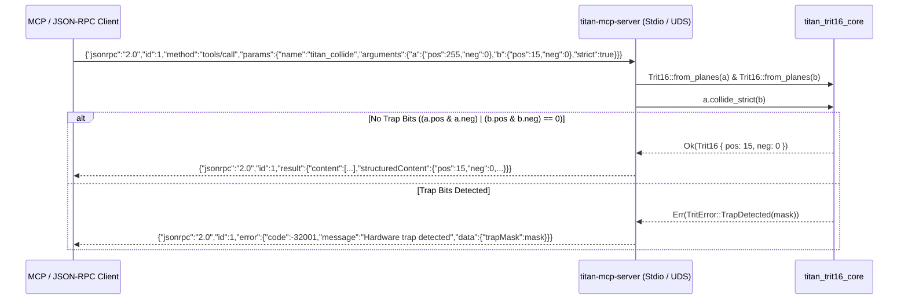

# MCP Transport & Server Architecture (`mcp-transport-decision.md`)

> [!NOTE]
> Updated in Phase 5 to document the verified, local-first Model Context Protocol (MCP) JSON-RPC 2.0 server (`titan-mcp/` / `titan-mcp-server`).

## 1. Transport & Crate Selection

| Aspect | Phase 1 Draft Assumption | Verified Phase 5 Implementation ([titan-mcp/](file:///data/data/com.termux/files/home/Titan_Trit16_SDK/titan-mcp)) |
|--------|--------------------------|---------------------------------------------------------------------------------------------------------------------|
| **Crate Dependencies** | Assumed unverified external `mcp-protocol = "0.4.2"` | **Zero external networking/RPC frameworks**; uses `titan_trit16_core`, `serde`, `serde_json`, and Rust `std` (`std::io`, `std::os::unix::net::UnixListener`, `std::net::TcpListener`). |
| **Primary Transport** | Unix Domain Socket / Stdio | **Stdio (`--stdio`, default)** + **Unix Domain Socket (`--socket <path>`)** + **Localhost TCP (`--tcp 127.0.0.1:<port>`)**. |
| **Safety Enforcement** | Unspecified | Enforces `#![forbid(unsafe_code)]` and a pre-allocation **64 KiB (`65,536` bytes)** per-line payload size guard (`MAX_PAYLOAD_BYTES`). |

---

## 2. Registered MCP Tools & JSON-RPC 2.0 Methods

The server supports both standard MCP tool discovery/invocation (`initialize`, `ping`, `tools/list`, `tools/call`) and direct JSON-RPC 2.0 method calls for all six Titan tools:

1. **`titan_encode`**:
   - **Inputs:** `{ "pos": u16, "neg": u16, "strict"?: bool }` or `{ "trits": [16 Kleene values], "strict"?: bool }`
   - **Output:** `{ "pos", "neg", "interleaved", "isValid", "hasTraps", "trapMask", "trapIndices", "trits", "display" }`
2. **`titan_decode`**:
   - **Inputs:** `{ "interleaved": u32, "strict"?: bool }`
   - **Output:** Decoded `(pos, neg)` planes, per-trit states, `trapMask`, and `[+ - 0 !]` register string.
3. **`titan_validate`**:
   - **Inputs:** `{ "pos": u16, "neg": u16 }` or `{ "interleaved": u32 }`
   - **Output:** `{ "isValid", "hasTraps", "trapMask", "trapCount", "trapIndices" }`
4. **`titan_detect_traps`**:
   - **Inputs:** `{ "pos": u16, "neg": u16, "strict"?: bool }`
   - **Output:** `{ "hasTraps", "trapMask", "trapCount", "trapIndices" }` (or JSON-RPC error `-32001` when `strict: true` and traps exist).
5. **`titan_evaluate`**:
   - **Inputs:** `{ "op": "and" | "or" | "not" | "collide" | "scalar_and" | "scalar_or" | "scalar_not" | "telemetry", "a": ..., "b"?: ..., "strict"?: bool }`
   - **Output:** Evaluates 16-trit bit-plane operations, strict trap-rejecting operations, scalar trap-dominant Kleene operations, or `Kleene::evaluate_telemetry`.
6. **`titan_collide`**:
   - **Inputs:** `{ "a": { "pos", "neg" }, "b": { "pos", "neg" }, "strict"?: bool }`
   - **Output:** 16-trit parallel `COLLIDE` consensus result.

---

## 3. Error Mapping & Trap Diagnostics

| Condition | JSON-RPC Error Code | Error `data` Payload |
|-----------|---------------------|----------------------|
| Invalid JSON syntax | `-32700` (`ERR_PARSE_ERROR`) | `null` |
| Oversized payload (`> 65536` bytes) or invalid JSON-RPC envelope | `-32600` (`ERR_INVALID_REQUEST`) | `null` |
| Unknown method or tool name | `-32601` (`ERR_METHOD_NOT_FOUND`) | `null` |
| Missing/out-of-range parameters | `-32602` (`ERR_INVALID_PARAMS`) | `null` |
| **Hardware Trap (`11`) in strict mode** | **`-32001` (`ERR_TRAP_DETECTED`)** | **`{ "trapMask": <u16>, "trapIndices": [...] }`** |
| Trit index out of range (`>= 16`) | `-32002` (`ERR_INVALID_INDEX`) | `{ "index": <u8> }` |

---

## 4. Sequence Diagram

